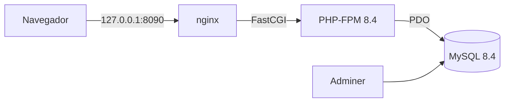

# Lucas

**Aplicación web de finanzas personales.** Cada persona registra sus ingresos y gastos, los organiza por cuentas y categorías, fija
presupuestos mensuales y persigue metas de ahorro. Un panel de administración gestiona a los usuarios sin acceder jamás a sus datos financieros.


## Por qué existe este proyecto

Quise construir una aplicación completa **sin apoyarme en un framework** para entender y demostrar cada capa: enrutamiento, MVC, sesiones,
protección contra CSRF y XSS, acceso a datos con PDO, roles y permisos, y una interfaz con sistema de diseño propio. No tiene dependencias de
terceros en producción: solo el autoload de Composer.

## Estado del proyecto

El proyecto avanza por fases, cada una con criterios de «terminado» verificables ([plan completo](docs/PLAN.md)).

| Fase | Alcance | Estado |
|---|---|---|
| 0 | Infraestructura: Docker, PHP-FPM, nginx, MySQL, conexión PDO, sesión, CSRF, usuarios de BD con mínimo privilegio | Completa |
| UI | Interfaz completa: sistema de diseño, 3 layouts y todas las pantallas (con datos de ejemplo) | Completa |
| 1 | Registro, inicio y cierre de sesión, roles, limitación de intentos, primera seed y pruebas automáticas | Completa |
| 2 | Dashboard de administración: métricas globales, usuarios (búsqueda, paginación, activar/desactivar, cambiar rol) | Completa |
| 3 | Cuentas con saldo calculado y categorías (propias y predeterminadas del administrador) | Completa |
| 4 | Movimientos: alta, edición, eliminación, filtros y paginación; el saldo de las cuentas se actualiza solo | Completa |
| 5–6 | Presupuestos, metas, panel y reportes | Siguiente (Fase 5) |
| 7 | Perfil, recuperación de contraseña, HTTPS y endurecimiento final | Pendiente |

> Hoy el registro, el login, los permisos por rol y la administración de usuarios, las cuentas, las categorías y los movimientos son reales, pero las pantallas del usuario (panel,
> presupuestos, metas y reportes) siguen con datos de ejemplo (exigen sesión, no guardan nada). Las secciones de *Funcionalidades* describen el alcance objetivo, no lo ya implementado.

## Funcionalidades previstas

**Personas usuarias**
- Registro público, inicio y cierre de sesión, recuperación de contraseña.
- Cuentas (efectivo, bancaria, tarjeta de crédito, ahorro) con saldo calculado en vivo.
- Categorías predeterminadas y propias.
- Movimientos de ingreso y gasto, con filtros por fecha, cuenta, categoría y tipo, y paginación.
- Presupuestos mensuales por categoría con avisos al 80 % y 100 %.
- Metas de ahorro con aportes y porcentaje de avance.
- Panel del mes, reportes gráficos y exportación a CSV.

**Administración**
- Métricas globales: usuarios totales, activos y nuevos, y registros por mes.
- Búsqueda, activación/desactivación y cambio de rol de usuarios, con salvaguardas (el sistema nunca se queda sin administradores).
- Gestión de las categorías predeterminadas.
- **Privacidad por diseño:** el administrador solo ve agregados y datos de cuenta; nunca movimientos, saldos, presupuestos ni metas.

## Arquitectura

MVC por capas en PHP 8.4 puro. Cada capa tiene una única responsabilidad y solo habla con la siguiente.



```
Petición → public/*.php → Controller → Validator → Repository → MySQL
                              └→ View → views/**/*.php → HTML
```

- **Un solo punto con SQL:** los repositorios, siempre con consultas preparadas y filtrados por el usuario de la sesión.
- **Contenedor de dependencias** propio con conexión perezosa a la base de datos.
- **Dinero sin `float`:** `DECIMAL(12,2)` en MySQL y cadenas/enteros en PHP; los cambios de saldo van en transacciones.
- **Fechas en UTC** en la base de datos, mostradas en la zona horaria del usuario.

Detalle completo en [`docs/ARQUITECTURA.md`](docs/ARQUITECTURA.md).

### Seguridad

| Medida | Protege de |
|---|---|
| Contraseñas con `password_hash` (bcrypt) y rehash automático | Filtración de credenciales |
| PDO con consultas preparadas reales (`EMULATE_PREPARES=false`) | Inyección SQL |
| Token CSRF por sesión + verificación de `Origin`/`Referer` en cada POST | CSRF |
| Salida siempre escapada; CSP `default-src 'self'` sin scripts ni estilos en línea | XSS |
| Cookie de sesión `HttpOnly` + `SameSite`, id regenerado al entrar, caducidad por inactividad | Robo de sesión |
| `X-Frame-Options: DENY`, `nosniff`, `Referrer-Policy`, `Permissions-Policy` | Clickjacking y sniffing |
| Rol verificado en el servidor en cada petición; datos siempre acotados por `id_usuario` | Escalada de privilegios, IDOR |
| Usuario de BD de la aplicación **sin permisos de esquema**; el de migraciones es aparte y PHP no lo conoce | Daño si la aplicación se compromete |
| Errores solo al log fuera de `APP_ENV=local` | Fuga de información |

### Sistema de diseño

Interfaz mobile-first sin herramientas de build ni recursos externos (todo es propio, por la CSP): tokens de diseño, componentes BEM
reutilizables y una librería de componentes en PHP (`App\View\Ui`) que devuelve HTML ya escapado. Contraste revisado para accesibilidad,
iconos SVG propios y estado comunicado con texto e icono, nunca solo con color.

## Inicio rápido

**Requisitos:** Docker y Docker Compose v2.

```bash
cp .env.example .env              # trae claves de DESARROLLO
docker compose up -d --build
```

La primera vez, MySQL crea la base y las tablas, y PHP genera `vendor/`. Espera a que `docker compose ps` muestre `db` en `healthy`.

| Servicio | Dirección |
|---|---|
| Aplicación | <http://localhost:8090> |
| Diagnóstico (solo `APP_ENV=local`) | <http://localhost:8090/status.php> |
| Adminer (servidor `db`, base `lucas`) | <http://localhost:8091> |

Todos los puertos escuchan únicamente en `127.0.0.1`.

**Pantallas disponibles:** [login](http://localhost:8090/login.php) · [registro](http://localhost:8090/registro.php) ·
[panel](http://localhost:8090/panel.php) · [movimientos](http://localhost:8090/movimientos.php) ·
[cuentas](http://localhost:8090/cuentas.php) · [presupuestos](http://localhost:8090/presupuestos.php) ·
[metas](http://localhost:8090/metas.php) · [reportes](http://localhost:8090/reportes.php) ·
[admin](http://localhost:8090/admin/index.php) · [usuarios](http://localhost:8090/admin/usuarios.php)

> Las claves de `.env.example` son de desarrollo y están pensadas solo para tu máquina. Cámbialas antes de exponer la aplicación.

## Configuración

Todo sale de `.env` (nunca se versiona; la plantilla es `.env.example`).

| Variable | Descripción | Por defecto |
|---|---|---|
| `APP_ENV` | `local`: errores en pantalla y `status.php`. Cualquier otro valor: modo seguro. | `local` |
| `APP_PORT` · `ADMINER_PORT` | Puertos locales | `8090` · `8091` |
| `APP_ORIGIN` | Origen público para validar los POST; con HTTPS activa la cookie `Secure` | `http://localhost:APP_PORT` |
| `DB_HOST` · `DB_PORT` · `DB_DATABASE` | Conexión a MySQL | `db` · `3306` · `lucas` |
| `DB_USERNAME` · `DB_PASSWORD` | Usuario de la aplicación (mínimo privilegio) | `lucas_app` |
| `DB_MIGRATION_USERNAME` · `DB_MIGRATION_PASSWORD` | Usuario de migraciones y scripts | `lucas_migrator` |
| `DB_ROOT_PASSWORD` | root de MySQL | — |
| `HOST_UID` · `HOST_GID` | Dueño de los archivos en Linux/WSL (`id -u`, `id -g`) | `1000` |
| `XDEBUG_MODE` | `off`, `debug`, `develop`… (puerto 9003) | `off` |

## Estructura

```
lucas-app/
├── docker-compose.yml · .env.example · bin/as-migrator
├── docker/       nginx (CSP, cabeceras de seguridad) y PHP (Dockerfile, ini seguro y de desarrollo, Xdebug)
├── database/     esquema, seed, creación de usuarios de BD y migraciones
├── docs/         requisitos, arquitectura, base de datos y plan
└── src/
    ├── app/      clases del dominio e infraestructura (namespace App\)
    ├── views/    plantillas y layouts
    ├── public/   único directorio expuesto por nginx (páginas, css, js)
    ├── scripts/  utilidades de consola
    └── tests/    pruebas
```

## Desarrollo

```bash
docker compose logs -f php                          # errores de PHP
docker compose exec php php tests/unit.php          # pruebas unitarias
bin/as-migrator php tests/integration.php           # repositorios contra una BD temporal
tests/smoke.sh                                      # punta a punta con curl (con la app en marcha)
tests/run-all.sh                                    # las tres suites, en orden
bin/as-migrator php scripts/create-admin.php correo # crear un administrador (pide la contraseña)
docker compose exec php composer dump-autoload      # tras añadir clases
bin/as-migrator php scripts/<script>.php            # scripts que cambian datos o esquema (usuario de migraciones)
docker compose down -v                              # parar y BORRAR la base
```

### Problemas frecuentes

| Síntoma | Causa y solución |
|---|---|
| `Falta DB_MIGRATION_PASSWORD en .env` | No existe `.env`: `cp .env.example .env`. |
| `Origen no permitido` (403) al enviar un formulario | `localhost` y `127.0.0.1` son orígenes distintos: usa el de `APP_ORIGIN`. |
| `status.php` devuelve 404 | Es intencional cuando `APP_ENV` no es `local`. |
| Cambié `database/*.sql` y no se refleja | MySQL solo los ejecuta con el volumen vacío: `docker compose down -v && docker compose up -d`. |
| Permisos extraños en `src/` | Ajusta `HOST_UID`/`HOST_GID` en `.env` y reconstruye. |
| Puerto ocupado | Cambia `APP_PORT`/`ADMINER_PORT` en `.env`. |

## Documentación

| Documento | Contenido |
|---|---|
| [`docs/REQUISITOS.md`](docs/REQUISITOS.md) | Requisitos funcionales y no funcionales, y estado de cada módulo |
| [`docs/ARQUITECTURA.md`](docs/ARQUITECTURA.md) | Capas, rutas, autenticación, seguridad, convenciones y sistema de diseño |
| [`docs/BASE-DE-DATOS.md`](docs/BASE-DE-DATOS.md) | Esquema, seed, permisos de MySQL y consultas clave |
| [`docs/PLAN.md`](docs/PLAN.md) | Fases de desarrollo con criterios de «terminado» |

## Autor

**Juan Antonio Ceballos Usuga** — desarrollo de software.

## Licencia

Distribuido bajo la licencia [MIT](LICENSE).
