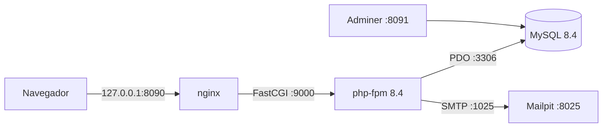
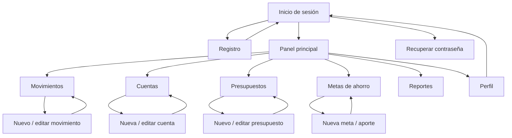
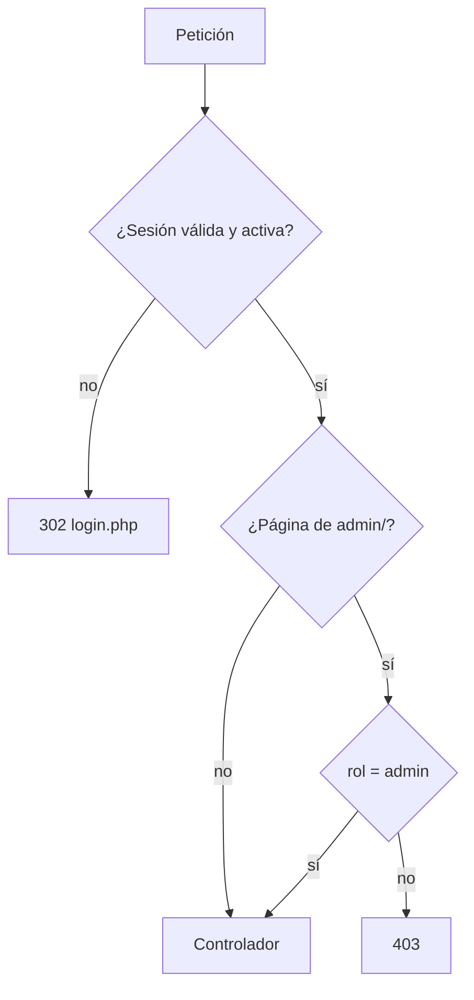

# Arquitectura

PHP 8.4 **sin frameworks**, patrón MVC por capas (RNF-18), MySQL con PDO y consultas preparadas (RNF-02). Cero dependencias de
terceros: solo el autoload de Composer.

## Servicios (Docker Compose)



| Servicio | Imagen | Puerto local |
|---|---|---|
| `nginx` | nginx 1.30 alpine | `127.0.0.1:8090` |
| `php` | `docker/php/Dockerfile` (php 8.4-fpm + pdo_mysql, intl, zip, opcache, xdebug) | — |
| `db` | mysql 8.4 | — (solo red interna) |
| `adminer` | adminer 6.3 | `127.0.0.1:8091` |
| `mailpit` | axllent/mailpit 1.21 (solo desarrollo: captura los correos sin enviarlos) | `127.0.0.1:8025` |

Producción (`docker-compose.prod.yml`, ver [`DESPLIEGUE.md`](DESPLIEGUE.md)) usa solo `nginx` (HTTPS), `php` y `db`, con el SMTP real y sin Adminer ni Mailpit.

## Capas

```
Petición → public/*.php → Controller → (Validator) → Repository → MySQL
                              │
                              └→ View::page() → views/**/*.php → HTML
```

| Capa | Carpeta | Responsabilidad | No hace |
|---|---|---|---|
| Entrada | `src/public/` | Un archivo por página: `require bootstrap.php` y llama a un método del controlador. | Lógica. |
| Controlador | `app/Controller/` | Lee la petición, exige sesión/rol, valida, llama al repositorio, elige vista o redirección. | SQL, HTML. |
| Validador | `app/Validation/` | Reglas de los datos de un formulario; devuelve errores en español. | Acceder a la BD (la unicidad la comprueba el controlador). |
| Repositorio | `app/Repository/` | **Único** sitio con SQL; recibe el `PDO`; siempre filtra por `id_usuario`. | Conocer HTTP. |
| Dominio | `app/Domain/` | Entidades pequeñas (`Usuario`, `Cuenta`, `Movimiento`...) hechas desde una fila. | I/O. |
| Vista | `src/views/` | HTML + `if`/`foreach`; todo dato sale con `escape()`. | Consultas, decidir códigos HTTP. |
| Autenticación | `app/Auth/` | `Autenticador` (credenciales, rehash), `LimitadorIntentos`. | HTTP, SQL. |
| Movimientos | `app/Movimientos/` | `ReglasMovimiento` (D8, puras), `GestionMovimientos` (la transacción con la cuenta bloqueada) y `Filtros` (limpia la URL del listado). | HTTP, HTML. |
| Presupuestos y metas | `app/Presupuestos/`, `app/Metas/` | `ReglasPresupuesto` y `ReglasAporte` (puras), `GestionMetas` (aportar, editar, cancelar y eliminar, cada una en una transacción con la cuenta y la meta bloqueadas). | HTTP, HTML. |
| Correo | `app/Mail/` | `Mailer` (interfaz), `SmtpMailer` (cliente SMTP mínimo, sin dependencias) y `Message` (arma el mensaje; puro; rechaza inyección de cabeceras). | HTTP, SQL. |
| Usuarios | `app/Usuarios/` | `EliminarCuenta`: borra la cuenta y todos sus datos en una transacción y en orden (D5). | HTTP, HTML. |
| Reportes y exportación | `app/Reportes/`, `app/Export/` | `Categorias` (agrupa los gastos para el gráfico) y `Csv` (formato para Excel y neutralización de fórmulas), ambas puras. | HTTP, SQL. |
| Utilidades | `app/Support/` | `Dinero` (montos exactos y formato colombiano), `Progreso` (avance de presupuestos y metas en centavos), `Mes` (mes y año de la URL, ventana de fechas). | HTTP, SQL. |
| Administración | `app/Admin/` | `ReglasAdmin` (RF-33, puras) y `GestionUsuarios` (la transacción con `FOR UPDATE`). | HTTP, HTML. |
| Infraestructura | `app/{Config,Database,Http,Logging,Security,View}`, `Container.php` | Ya existe (Fase 0). | — |

`Container` construye los repositorios con la conexión **perezosa** (no se abre hasta que alguien la pide).

## Estructura de carpetas

```
lucas-app/
├── docker-compose.yml  .env(.example)  bin/as-migrator
├── docker/{nginx,php}/         configuración de nginx (CSP, cabeceras) y PHP (ini seguro + ini de desarrollo, xdebug)
├── database/                   01-schema.sql · 02-seed.sql · 03-users.sh · migrations/
├── docs/                       esta documentación
├── tests/                      smoke.sh (curl) y run-all.sh (todas las suites)
└── src/
    ├── bootstrap.php           autoload de Composer
    ├── app/                    clases (namespace App\) y funciones globales (support.php, Security/*.php)
    ├── views/{layout,partials,auth,panel,cuentas,movimientos,presupuestos,metas,reportes,admin}/
    ├── public/                 único directorio que ve nginx: páginas, css/, js/, img/
    ├── scripts/                consola: create-admin.php, db-check.php...
    └── tests/                  unit.php, integration.php, harness.php
```

## Páginas y rutas

| Página (`src/public/`) | Acceso | Método | Qué hace |
|---|---|---|---|
| `index.php` | público | GET | Redirige: sin sesión → `login.php`; `admin` → `admin/index.php`; `usuario` → `panel.php`. |
| `registro.php` | público | GET/POST | Crea un usuario con rol `usuario` (RF-24). |
| `login.php` · `logout.php` | público · sesión | GET/POST · POST | Inicia/cierra sesión (RF-02). |
| `recuperar.php` | público | GET/POST | Pide el enlace de recuperación por correo (RF-04). Misma respuesta exista o no el correo. |
| `restablecer.php?token=` | público | GET/POST | Elige la contraseña nueva con el enlace del correo (RF-04). |
| `salud.php` | público | GET | `200 {"estado":"ok"}` o `503`, para monitorizar (RNF-14). No revela nada. |
| `panel.php` | usuario | GET | Ingresos, gastos y balance del mes; saldo total (RF-21). |
| `movimientos.php` · `movimiento-form.php` · `movimiento-eliminar.php` | usuario | GET/POST | Listado con filtros y paginación; crear, editar, eliminar (RF-10 a RF-14). |
| `cuentas.php` · `cuenta-form.php` | usuario | GET/POST | RF-05 a RF-07. |
| `categorias.php` | usuario | GET/POST | RF-09. |
| `presupuestos.php` · `metas.php` | usuario | GET/POST | RF-15 a RF-20. |
| `reportes.php` · `exportar.php` | usuario | GET | Gráficos y CSV (RF-22, RF-23). |
| `perfil.php` | usuario | GET/POST | Nombre, moneda, contraseña; eliminar cuenta (RF-03, RNF-20). |
| `admin/index.php` | **admin** | GET | Dashboard con métricas globales (RF-28, RF-29). |
| `admin/usuarios.php` | **admin** | GET/POST | Lista, búsqueda, activar/desactivar, cambiar rol (RF-30 a RF-33). |
| `admin/categorias.php` | **admin** | GET/POST | Categorías predeterminadas (RF-34). |
| `status.php` | solo `APP_ENV=local` | GET | Diagnóstico del stack. |

## Mapa de navegación (usuario)



## Autenticación y autorización



- Sesión en `$_SESSION` (`user_id`, `user_name`, `user_email`, **`user_role`**; son una copia para mostrar), cookie `lucas_session` `HttpOnly` + `SameSite=Lax`
  (+ `Secure` si `APP_ORIGIN` es https), caduca a los 30 min de inactividad (RNF-06), id regenerado al iniciar sesión.
- `require_login()` exige sesión y `require_role('admin')` además el rol (403 si no coincide). **En cada petición** `resolve_user_session()` vuelve a leer
  al usuario de la BD (por clave primaria): si está inactivo se cierra la sesión (`login.php?msg=revoked`) y un cambio de rol vale al instante.
- **Recuperar contraseña** (RF-04): token de 256 bits, solo su hash en BD, 30 min y un solo uso (se gasta en una transacción con la fila bloqueada). La respuesta de `recuperar.php` se envía antes de trabajar (`fastcgi_finish_request`) y es idéntica exista o no el correo. Cambiar la contraseña cierra las demás sesiones: la sesión guarda una huella del hash y se compara en cada petición.
- **Panel, reportes y CSV** (RF-21 a RF-23): `ReporteRepository` agrega por mes con la ventana `fecha >= … AND fecha < …`. `exportar.php` es un GET que solo lee y recorre los movimientos por lotes con paginación por cursor; todo texto del usuario pasa por `Csv::texto()` contra la inyección de fórmulas.
- **Presupuestos y metas** (RF-15 a RF-20): lo gastado de un presupuesto y lo ahorrado de una meta se calculan al leer (nunca quedan desactualizados). Aportar bloquea la cuenta y la meta; cancelar una meta devuelve el dinero a las cuentas; el aviso de presupuesto (RF-17) se calcula al momento, sin guardarse.
- **Movimientos** (RF-10 a RF-14): guardar un movimiento bloquea la cuenta (`FOR UPDATE`) y comprueba D8 dentro de la transacción; lo ajeno o inexistente responde 404. El saldo se calcula, así que no hay que «actualizarlo».
- **Administración de usuarios** (RF-31 a RF-33): activar/desactivar y cambiar rol van en una transacción que bloquea a los admins activos (`FOR UPDATE`, siempre por id) y al objetivo; quien actúa debe seguir siendo admin activo dentro de ella. Los avisos tras la redirección usan `Http\Flash`.
- **Limitación de intentos** (RNF-24): `Auth\LimitadorIntentos` sobre la tabla `intentos_acceso`; 429 con `Retry-After` al pasarse (5 por correo, 20 por IP, 15 min).
- Contraseñas con `password_hash(PASSWORD_DEFAULT)` y `password_verify()`; se rehashean al iniciar sesión si el algoritmo cambió (RNF-01).
- **Propiedad de los datos:** el `id_usuario` de cada consulta sale de la sesión. Si un id de la URL no pertenece al usuario, la respuesta es 404 (RNF-04).
- **El rol no se confía al cliente:** se lee de la BD al iniciar sesión y se guarda en la sesión; ningún formulario público lo acepta (RF-25).

## Seguridad en capas (heredado del esqueleto)

| Capa | Dónde | Protege de |
|---|---|---|
| CSP `default-src 'self'` + cabeceras (`nosniff`, `X-Frame-Options: DENY`, `Referrer-Policy`) | `docker/nginx/default.conf` | XSS, clickjacking |
| Comprobación de `Origin`/`Referer` en cada POST | `Security/request-guard.php` | Peticiones de otros sitios |
| Token CSRF por sesión, `hash_equals` | `Security/csrf.php` | CSRF (RNF-03) |
| Cookie `SameSite=Lax` + `HttpOnly` | `Security/session.php` | Robo/uso de sesión |
| `escape()` en toda salida | `support.php` | XSS (RNF-03) |
| PDO con `EMULATE_PREPARES=false` | `Database/Connection.php` | Inyección SQL (RNF-02) |
| Usuario de BD sin DDL | `database/03-users.sh` | Daño si la app se compromete |
| Errores al log, nunca a pantalla (salvo `local`) | `docker/php/php.ini` | Fuga de información (RNF-12) |

## Convenciones

- **Idioma:** nombres de dominio en español como en la BD (`Cuenta`, `Movimiento`, `monto`, `saldo`); infraestructura en inglés (`Container`, `Connection`). Textos al usuario, en español.
- **Dinero:** `DECIMAL(12,2)` en BD y **cadenas** o enteros de centavos en PHP; nunca `float` (RNF-16). `Support\Dinero` lee lo que escribe la persona (`1.250.000,50`), suma en centavos y da formato. Cambios de saldo dentro de una transacción SQL.
- **POST + CSRF** para todo lo que modifica datos; GET nunca cambia estado. Tras un POST correcto: redirección (patrón PRG).
- **Errores:** `Failure::describe()` traduce excepciones a 503/500 y registra el detalle; el visitante ve un mensaje genérico.
- **Estilo:** `declare(strict_types=1)`, PSR-12, `.editorconfig` (UTF-8, LF, 4 espacios).

## Front-end

**Mobile-first, sin build:** `css/*.css` (ver más abajo) y `js/app.js` en `src/public/`; las páginas `.html` son vistas en `views/app/`, `views/auth/` y `views/admin/`; el `<head>` y el menú son `views/layout/` (`View::page($vista, $datos, $título, $usuario, $layout, $nav)` con diseños `plain`, `auth`, `app` y `admin`).
**Sin estilos en línea:** la CSP los bloquea, así que los valores dinámicos (barras de progreso, gráficos) van en `data-v` / `data-h` y `app.js` los aplica con CSSOM. El dashboard de administración usa el mismo
sistema visual con su propio menú. **Restricción de la CSP:** nada externo; la fuente *Inter* debe alojarse en `public/fonts/`.
La fuente *Inter* no está alojada (se usa la pila del sistema); para añadirla, `@font-face` apuntando a `public/fonts/`. Los gráficos (RF-22, RF-29) se dibujan con SVG/CSS propios o una librería copiada a `public/js/`, no desde un CDN.

### Sistema de diseño

La interfaz se arma con componentes reutilizables; para cambiar el aspecto de algo se toca **un** sitio:

| Capa | Archivo | Contenido |
|---|---|---|
| Tokens | `public/css/tokens.css` | Paleta de marca (`#061A24 #0B3A53 #0FA3B1 #B5E2FA #F3FAFF`), tonos derivados con su contraste, tipografía, espaciado, radios, sombras. Es el único sitio donde viven los valores. |
| Base | `public/css/base.css` | Reinicio, tipografía, foco visible, utilidades (`.sr-only`, `.muted`...), `prefers-reduced-motion`. |
| Componentes | `public/css/components.css` | Un bloque BEM por componente (`.btn`, `.badge`, `.card`, `.field`, `.table`, `.donut`...). No dependen de la página. |
| Layout | `public/css/layout.css` | Menú lateral, cabecera móvil, rejillas, pantalla de acceso y reglas responsivas (640 · 768 · 900 · 1024 px). |
| Páginas | `public/css/pages.css` | Solo composición propia de cada pantalla (tarjeta de saldo, metas, filtros...); no redefine componentes. |

**Componentes en PHP:** `App\View\Ui` (`app/View/Ui.php`) tiene un método por componente: átomos (`icon`, `logo`, `button`, `iconButton`, `badge`, `avatar`, `money`, `progress`), moléculas (`field`, `select`, `segmented`, `notice`, `stat`, `listItem`, `pageHead`, `pagination`) y organismos (`cardOpen`/`cardClose`, `table`, `donut`, `bars`, `splitBar`, `postForm`, `actions`, `fab`). En una vista: `<?= Ui::badge('Activo', 'brand') ?>`.
Cada método devuelve un `App\View\Html` ya escapado: un `Html` se inserta tal cual y cualquier otro valor se escapa, así que los componentes se anidan sin escapar dos veces ni abrir XSS. Los iconos son SVG propios (constantes en `Ui::ICONS`; sin emojis ni fuentes de iconos).

**Color y accesibilidad:** el teal de marca solo da 3,0:1 sobre blanco, así que para **texto** se usa `--teal-text` (5,4:1). El único color añadido a la paleta es `--danger`, reservado a errores y presupuesto excedido; el estado además se dice con texto e icono, nunca solo con color.

