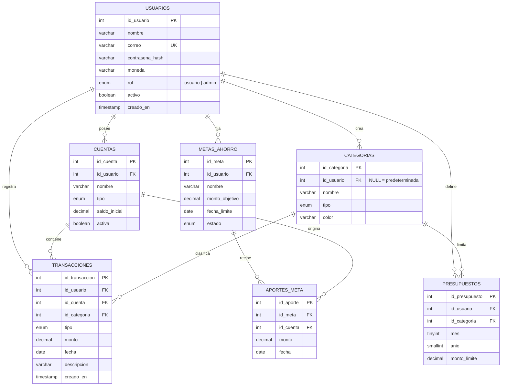

# Base de datos

Motor: MySQL 8.4, base `lucas`, `utf8mb4`. El esquema completo está en [`database/01-schema.sql`](../database/01-schema.sql).
Las fechas `TIMESTAMP` se guardan en UTC (la sesión de MySQL fuerza `+00:00`) y se muestran en `America/Bogota` con `format_utc_datetime()`.

## Modelo entidad-relación

## Diccionario de datos

**usuarios**
| Campo | Tipo | Clave | Descripción |
|---|---|---|---|
| id_usuario | INT AUTO_INCREMENT | PK | Identificador del usuario |
| nombre | VARCHAR(80) | | Nombre completo |
| correo | VARCHAR(120) | UNIQUE | Correo para iniciar sesión |
| contrasena_hash | VARCHAR(255) | | Contraseña cifrada |
| moneda | CHAR(3) | | Moneda por defecto (COP) |
| rol | ENUM('usuario','admin') | INDEX (rol, activo) | Distingue administradores (RF-27, RF-32) |
| activo | BOOLEAN | INDEX (rol, activo) | Desactivar sin borrar datos (RF-31); permite contar administradores activos (RF-33) |
| creado_en | TIMESTAMP | | Fecha de registro |

**intentos_acceso** (limitación de intentos, RNF-24)
| Campo | Tipo | Clave | Descripción |
|---|---|---|---|
| id_intento | INT AUTO_INCREMENT | PK | Identificador |
| tipo | ENUM('login','registro') | INDEX (tipo, clave, creado_en) | Qué se intentó |
| clave | VARCHAR(80) | | `ip:<dirección>` o `correo:<sha256 del correo>` (nunca el correo en claro) |
| creado_en | TIMESTAMP | | Momento del intento (UTC); cuenta lo de los últimos 15 min |

No tiene relaciones: es una tabla de apoyo, sin FK, que se purga sola.

**cuentas**
| Campo | Tipo | Clave | Descripción |
|---|---|---|---|
| id_cuenta | INT AUTO_INCREMENT | PK | Identificador de la cuenta |
| id_usuario | INT | FK → usuarios | Dueño de la cuenta |
| nombre | VARCHAR(60) | | Ej.: "Bancolombia ahorros" |
| tipo | ENUM('efectivo','bancaria','tarjeta_credito','ahorro') | | Tipo de cuenta |
| saldo_inicial | DECIMAL(12,2) | | Saldo con el que se crea |
| activa | BOOLEAN | | Si sigue en uso |

**categorias**
| Campo | Tipo | Clave | Descripción |
|---|---|---|---|
| id_categoria | INT AUTO_INCREMENT | PK | Identificador |
| id_usuario | INT NULL | FK → usuarios | Dueño; NULL si es predeterminada |
| nombre | VARCHAR(50) | | Nombre de la categoría |
| tipo | ENUM('ingreso','gasto') | | Naturaleza |
| color | CHAR(7) | | Color para gráficos (#RRGGBB) |

**transacciones**
| Campo | Tipo | Clave | Descripción |
|---|---|---|---|
| id_transaccion | INT AUTO_INCREMENT | PK | Identificador |
| id_usuario | INT | FK → usuarios | Quién la registró |
| id_cuenta | INT | FK → cuentas | Cuenta afectada |
| id_categoria | INT | FK → categorias | Clasificación |
| tipo | ENUM('ingreso','gasto') | | Tipo de movimiento |
| monto | DECIMAL(12,2) | | Valor positivo (CHECK monto > 0) |
| fecha | DATE | | Fecha del movimiento |
| descripcion | VARCHAR(150) | | Detalle opcional |
| creado_en | TIMESTAMP | | Fecha de creación del registro |

**presupuestos**
| Campo | Tipo | Clave | Descripción |
|---|---|---|---|
| id_presupuesto | INT AUTO_INCREMENT | PK | Identificador |
| id_usuario | INT | FK → usuarios | Dueño |
| id_categoria | INT | FK → categorias | Categoría limitada |
| mes | TINYINT | | 1 a 12 |
| anio | SMALLINT | | Año |
| monto_limite | DECIMAL(12,2) | | Límite de gasto |
| | | UNIQUE (id_usuario, id_categoria, mes, anio) | Evita duplicados |

**metas_ahorro**
| Campo | Tipo | Clave | Descripción |
|---|---|---|---|
| id_meta | INT AUTO_INCREMENT | PK | Identificador |
| id_usuario | INT | FK → usuarios | Dueño |
| nombre | VARCHAR(80) | | Nombre de la meta |
| monto_objetivo | DECIMAL(12,2) | | Cuánto se quiere ahorrar |
| fecha_limite | DATE | | Fecha para lograrla |
| estado | ENUM('en_curso','lograda','cancelada') | | Estado actual |

**aportes_meta**
| Campo | Tipo | Clave | Descripción |
|---|---|---|---|
| id_aporte | INT AUTO_INCREMENT | PK | Identificador |
| id_meta | INT | FK → metas_ahorro | Meta que recibe el aporte |
| id_cuenta | INT | FK → cuentas | Cuenta de donde sale el dinero |
| monto | DECIMAL(12,2) | | Valor aportado |
| fecha | DATE | | Fecha del aporte |

## Relaciones

| Relación | Cardinalidad | Explicación |
|---|---|---|
| usuarios → cuentas | 1 : N | Un usuario tiene varias cuentas; cada cuenta pertenece a un usuario. |
| usuarios → categorias | 1 : N | Un usuario puede crear varias categorías propias. |
| usuarios → transacciones | 1 : N | Un usuario registra muchos movimientos. |
| cuentas → transacciones | 1 : N | Una cuenta tiene muchos movimientos. |
| categorias → transacciones | 1 : N | Una categoría clasifica muchos movimientos. |
| usuarios → presupuestos | 1 : N | Un usuario define varios presupuestos. |
| categorias → presupuestos | 1 : N | Una categoría puede tener un presupuesto por cada mes. |
| usuarios → metas_ahorro | 1 : N | Un usuario puede tener varias metas. |
| metas_ahorro → aportes_meta | 1 : N | Una meta recibe varios aportes. |
| cuentas → aportes_meta | 1 : N | De una cuenta pueden salir varios aportes. |

## Orden de inicialización

MySQL ejecuta `database/` solo cuando el volumen está vacío, en orden alfabético:

| Archivo | Qué hace |
|---|---|
| `01-schema.sql` | Crea las 8 tablas (7 de negocio + `intentos_acceso`). |
| `02-seed.sql` | **Primera seed**: categorías predeterminadas y el administrador inicial (ver abajo). |
| `03-users.sh` | Crea los usuarios de MySQL con mínimo privilegio. Va después porque los permisos por tabla exigen que existan. |
| `migrations/NNN-*.sql` | Cambios posteriores. Se aplican a mano con `bin/as-migrator`; una base nueva ya los trae en `01-schema.sql`. |

Para empezar de cero (borra los datos): `docker compose down -v && docker compose up -d --build`.

## Seed

### Administrador inicial
| Campo | Valor (solo desarrollo) |
|---|---|
| nombre | `Administrador` |
| correo | `admin@lucas.local` |
| contraseña | `Admin#2026dev` (guardada como hash bcrypt, **nunca** en claro en el SQL) |
| rol / activo | `admin` / `1` |

- `02-seed.sql` empieza con `SET NAMES utf8mb4`: el cliente `mysql` de la imagen arranca en `latin1` y, sin eso, las tildes de las categorías se guardarían mal («Alimentación»).
- El hash lo genera `password_hash()` y se escribe en `02-seed.sql` con `INSERT IGNORE`. La seed está pensada para ejecutarse **una sola vez** (volumen vacío): el admin no se duplica gracias al `UNIQUE` del correo, pero las categorías (`categorias` no tiene clave única, y con `NULL` MySQL permite repetidos) sí se duplicarían si se lanzara a mano otra vez.
- Es una clave **conocida y pública**: sirve para entrar la primera vez en local. Cámbiala desde el perfil o crea otro administrador
  y desactiva este antes de exponer la app (RNF-23).
- Para un entorno real, el administrador se crea con `bin/as-migrator php scripts/create-admin.php correo ["Nombre"]`, que pide la
  contraseña por terminal (sin mostrarla), y `02-seed.sql` no se usa para ese dato.

### Categorías predeterminadas (RF-08)
`id_usuario = NULL`, visibles para todos y editables solo por un administrador (RF-34):

| Gastos | Color | Ingresos | Color |
|---|---|---|---|
| Alimentación | `#E4572E` | Salario | `#2E9E6B` |
| Transporte | `#F3A712` | Ventas / independiente | `#0FA3B1` |
| Vivienda | `#7A5195` | Intereses | `#4C78A8` |
| Servicios | `#4C78A8` | Otros ingresos | `#8DA0AB` |
| Salud | `#D1495B` | | |
| Educación | `#0B3A53` | | |
| Entretenimiento | `#EF8354` | | |
| Otros gastos | `#8DA0AB` | | |

## Permisos de MySQL

| Usuario | Para qué | Permisos |
|---|---|---|
| `lucas_app` | PHP, en cada petición | `SELECT, INSERT, UPDATE, DELETE` solo sobre las 8 tablas. Sin DDL. |
| `lucas_migrator` | Migraciones, scripts, pruebas | Todo sobre la base `lucas` y sobre las bases temporales `lucas_test%` de las pruebas de integración; nada más. PHP no conoce su clave (`bin/as-migrator`). |
| `root` | Administrar el servidor | Solo `DB_ROOT_PASSWORD`; la app no lo usa. |

## Consultas clave

- **Saldo de una cuenta** (no se guarda): `saldo_inicial + Σ ingresos − Σ gastos − Σ aportes_meta`, con subconsultas por cuenta en `CuentaRepository`. Una tarjeta de crédito puede tener saldo negativo (lo que se debe). El saldo total suma solo las cuentas activas.
- **Borrar una categoría** (D4): el `DELETE` falla por la clave foránea si hay movimientos o presupuestos (`SQLSTATE 23000`); la aplicación lo traduce en un aviso.
- **Listado de movimientos** (RNF-09): `WHERE id_usuario = :u [AND fecha BETWEEN … AND cuenta/categoría/tipo]` ordenado por `fecha DESC, id_transaccion DESC` con `LIMIT 20 OFFSET …`; el índice `idx_usuario_fecha (id_usuario, fecha)` sirve el filtro y el orden, y las claves foráneas indexan cuenta y categoría.
- **Gasto de un presupuesto**: `SUM(monto)` de `transacciones` de gasto, de esa categoría y del usuario, con `fecha >= primer día del mes AND fecha < primer día del mes siguiente` (usa `idx_usuario_fecha`).
- **Ahorrado en una meta**: `SUM(monto)` de `aportes_meta` de esa meta. Los aportes restan del saldo de su cuenta (ver «Saldo de una cuenta»); al cancelar una meta se borran y el dinero vuelve.
- **Administradores activos** (RF-33): `SELECT COUNT(*) FROM usuarios WHERE rol='admin' AND activo=1`, dentro de la misma transacción que el cambio.
- **Registros por mes** (RF-29): `GROUP BY DATE_FORMAT(creado_en,'%Y-%m')` sobre los últimos 12 meses.
- **Intentos recientes** (RNF-24): `COUNT(*) FROM intentos_acceso WHERE tipo=? AND clave=? AND creado_en >= NOW() - INTERVAL 900 SECOND`; máximo 5 por correo y 20 por IP.
- Cualquier consulta de datos de un usuario lleva `WHERE id_usuario = :id` con el id **de la sesión**, nunca el de la URL (RNF-04).
