# Base de datos

Motor: MySQL 8.4, base `lucas`, `utf8mb4`. El esquema completo está en [`database/01-schema.sql`](../database/01-schema.sql).
Las fechas `TIMESTAMP` se guardan en UTC (la sesión de MySQL fuerza `+00:00`) y se muestran en `America/Bogota` con `format_utc_datetime()`.

## Modelo entidad-relación

```mermaid
erDiagram
    USUARIOS ||--o{ CUENTAS : posee
    USUARIOS ||--o{ CATEGORIAS : crea
    USUARIOS ||--o{ TRANSACCIONES : registra
    USUARIOS ||--o{ PRESUPUESTOS : define
    USUARIOS ||--o{ METAS_AHORRO : fija
    USUARIOS ||--o{ DEUDAS : contrae
    USUARIOS ||--o{ TRANSFERENCIAS : ordena
    USUARIOS ||--o{ MOVIMIENTOS_RECURRENTES : programa
    USUARIOS ||--o{ TASAS_CAMBIO : configura
    USUARIOS ||--o{ ESPACIO_MIEMBROS : participa
    USUARIOS ||--o{ SESIONES_USUARIO : mantiene
    USUARIOS ||--o{ RESTABLECIMIENTOS : solicita
    USUARIOS ||--o{ VERIFICACIONES_CORREO : confirma
    USUARIOS ||--o{ CODIGOS_RECUPERACION : respalda
    USUARIOS ||--o{ NOTIFICACIONES_ENVIADAS : recibe
    ESPACIOS ||--o{ ESPACIO_MIEMBROS : integra
    ESPACIOS ||--o{ ESPACIO_INVITACIONES : invita
    ESPACIOS ||--o{ CUENTAS : agrupa
    ESPACIOS ||--o{ CATEGORIAS : agrupa
    ESPACIOS ||--o{ TRANSACCIONES : agrupa
    ESPACIOS ||--o{ PRESUPUESTOS : agrupa
    ESPACIOS ||--o{ METAS_AHORRO : agrupa
    ESPACIOS ||--o{ DEUDAS : agrupa
    ESPACIOS ||--o{ TRANSFERENCIAS : agrupa
    ESPACIOS ||--o{ MOVIMIENTOS_RECURRENTES : agrupa
    ESPACIOS ||--o{ TASAS_CAMBIO : agrupa
    CUENTAS ||--o{ TRANSACCIONES : contiene
    CUENTAS ||--o{ CUOTAS_TARJETA : difiere
    CUENTAS ||--o{ APORTES_META : origina
    CUENTAS ||--o{ PAGOS_DEUDA : debita
    CUENTAS ||--o{ TRANSFERENCIAS : mueve
    CUENTAS ||--o{ MOVIMIENTOS_RECURRENTES : afecta
    TRANSACCIONES ||--o{ CUOTAS_TARJETA : desglosa
    CATEGORIAS ||--o{ TRANSACCIONES : clasifica
    CATEGORIAS ||--o{ PRESUPUESTOS : limita
    CATEGORIAS ||--o{ MOVIMIENTOS_RECURRENTES : clasifica
    METAS_AHORRO ||--o{ APORTES_META : recibe
    DEUDAS ||--o{ PAGOS_DEUDA : amortiza
```

## Diccionario de datos

**usuarios**
| Campo | Tipo | Clave | Descripción |
|---|---|---|---|
| id_usuario | INT AUTO_INCREMENT | PK | Identificador del usuario |
| nombre | VARCHAR(80) | | Nombre completo |
| correo | VARCHAR(120) | UNIQUE | Correo para iniciar sesión |
| contrasena_hash | VARCHAR(255) | | Contraseña cifrada |
| moneda | CHAR(3) | | Moneda por defecto (COP) |
| rol | ENUM('usuario','admin') | INDEX (rol, activo) | Distingue administradores (RF-27, RF-32) |
| activo | BOOLEAN | INDEX (rol, activo) | Desactivar sin borrar datos (RF-31); permite contar administradores activos (RF-33) |
| creado_en | TIMESTAMP | | Fecha de registro |

**intentos_acceso** (limitación de intentos, RNF-24)
| Campo | Tipo | Clave | Descripción |
|---|---|---|---|
| id_intento | INT AUTO_INCREMENT | PK | Identificador |
| tipo | ENUM('login','registro','recuperacion','clave') | INDEX (tipo, clave, creado_en) | Qué se intentó (`clave` = cambio de contraseña desde el perfil) |
| clave | VARCHAR(80) | | `ip:<dirección>` o `correo:<sha256 del correo>` (nunca el correo en claro) |
| creado_en | TIMESTAMP | | Momento del intento (UTC); cuenta lo de los últimos 15 min |

No tiene relaciones: es una tabla de apoyo, sin FK, que se purga sola.

**restablecimientos** (recuperar contraseña, RF-04)
| Campo | Tipo | Clave | Descripción |
|---|---|---|---|
| id_restablecimiento | INT AUTO_INCREMENT | PK | Identificador |
| id_usuario | INT | FK → usuarios (CASCADE) | A quién pertenece el enlace |
| token_hash | CHAR(64) | UNIQUE | SHA-256 del token: el token en sí **nunca** se guarda |
| creado_en · expira_en | TIMESTAMP | | Vigencia de 30 minutos |
| usado_en | TIMESTAMP NULL | | Se llena al usarlo: un enlace sirve una sola vez |

**verificaciones_correo** (verificar el correo del registro, A1)
| Campo | Tipo | Clave | Descripción |
|---|---|---|---|
| id_verificacion | INT AUTO_INCREMENT | PK | Identificador |
| id_usuario | INT | FK → usuarios (CASCADE), INDEX | A quién pertenece el enlace |
| correo | VARCHAR(120) | | El correo que se verifica: si la cuenta cambia de correo, el enlace deja de valer |
| token_hash | CHAR(64) | UNIQUE | SHA-256 del token: el token en sí **nunca** se guarda |
| creado_en · expira_en | TIMESTAMP · DATETIME | | Vigencia de 48 horas |
| usado_en | DATETIME NULL | | Se llena al usarlo: un enlace sirve una sola vez |

Índices de los espacios compartidos (R9): `transacciones (id_espacio, fecha)`, `transferencias (id_espacio, fecha)` y `movimientos_recurrentes (id_espacio, activo, proxima_fecha)`, para que los listados de un espacio salgan ordenados del propio índice.

`usuarios.correo_verificado_en` (DATETIME NULL) guarda **cuándo** se verificó el correo; `NULL` = sin verificar. Sin verificar, la cuenta funciona, pero no recibe correo de Lucas y no puede enviar ni aceptar invitaciones a espacios (RNF-25). Restablecer la contraseña con el enlace del correo también lo verifica.

**codigos_recuperacion** (códigos de respaldo del 2FA, M7)
| Campo | Tipo | Clave | Descripción |
|---|---|---|---|
| id_codigo | INT AUTO_INCREMENT | PK | Identificador |
| id_usuario | INT | FK → usuarios (CASCADE), UNIQUE con `codigo_hash` | A quién pertenece |
| codigo_hash | CHAR(64) | | SHA-256 del código (80 bits); el código en claro solo se muestra al generarlo |
| creado_en · usado_en | TIMESTAMP · DATETIME NULL | | `usado_en` se llena al gastarlo: sirve una sola vez |

`usuarios.totp_secreto` (VARCHAR 255) guarda el secreto TOTP **cifrado** con libsodium y la clave `APP_KEY` (nunca en claro); `totp_activado_en` (DATETIME NULL) indica cuándo se confirmó (`NULL` = 2FA no activo) y `totp_ultimo_paso` (BIGINT) el último paso de 30 s aceptado, para que un código no pueda reutilizarse (RNF-26).

**cola_correo** (cola de correo saliente, M4)
| Campo | Tipo | Clave | Descripción |
|---|---|---|---|
| id_correo | INT AUTO_INCREMENT | PK | Identificador |
| destinatario · asunto | VARCHAR | | A quién y qué asunto |
| cuerpo | MEDIUMTEXT | | El mensaje; **se vacía** cuando sale o se da por perdido (puede llevar enlaces con token) |
| estado | ENUM('pendiente','enviado','fallido') | INDEX con `proximo_intento` | Ciclo de vida |
| intentos · proximo_intento · ultimo_error | TINYINT · DATETIME · VARCHAR | | Reintentos con espera creciente (1, 5, 15, 60 min; máx. 5 intentos) |
| creado_en · procesado_en | TIMESTAMP · DATETIME NULL | | Historial (se purga a los 7 días los enviados y a los 30 los fallidos) |

**cuentas**
| Campo | Tipo | Clave | Descripción |
|---|---|---|---|
| id_cuenta | INT AUTO_INCREMENT | PK | Identificador de la cuenta |
| id_usuario | INT | FK → usuarios | Dueño de la cuenta |
| nombre | VARCHAR(60) | | Ej.: "Bancolombia ahorros" |
| tipo | ENUM('efectivo','bancaria','tarjeta_credito','ahorro') | | Tipo de cuenta |
| saldo_inicial | DECIMAL(12,2) | | Saldo con el que se crea |
| activa | BOOLEAN | | Si sigue en uso |

**categorias**
| Campo | Tipo | Clave | Descripción |
|---|---|---|---|
| id_categoria | INT AUTO_INCREMENT | PK | Identificador |
| id_usuario | INT NULL | FK → usuarios | Dueño; NULL si es predeterminada |
| nombre | VARCHAR(50) | | Nombre de la categoría |
| tipo | ENUM('ingreso','gasto') | | Naturaleza |
| color | CHAR(7) | | Color para gráficos (#RRGGBB) |

**transacciones**
| Campo | Tipo | Clave | Descripción |
|---|---|---|---|
| id_transaccion | INT AUTO_INCREMENT | PK | Identificador |
| id_usuario | INT | FK → usuarios | Quién la registró |
| id_cuenta | INT | FK → cuentas | Cuenta afectada |
| id_categoria | INT | FK → categorias | Clasificación |
| tipo | ENUM('ingreso','gasto') | | Tipo de movimiento |
| monto | DECIMAL(12,2) | | Valor positivo (CHECK monto > 0) |
| fecha | DATE | | Fecha del movimiento |
| descripcion | VARCHAR(150) | | Detalle opcional |
| creado_en | TIMESTAMP | | Fecha de creación del registro |

**presupuestos**
| Campo | Tipo | Clave | Descripción |
|---|---|---|---|
| id_presupuesto | INT AUTO_INCREMENT | PK | Identificador |
| id_usuario | INT | FK → usuarios | Dueño |
| id_categoria | INT | FK → categorias | Categoría limitada |
| mes | TINYINT | | 1 a 12 |
| anio | SMALLINT | | Año |
| monto_limite | DECIMAL(12,2) | | Límite de gasto |
| | | UNIQUE (id_usuario, id_categoria, mes, anio) | Evita duplicados |

**metas_ahorro**
| Campo | Tipo | Clave | Descripción |
|---|---|---|---|
| id_meta | INT AUTO_INCREMENT | PK | Identificador |
| id_usuario | INT | FK → usuarios | Dueño |
| nombre | VARCHAR(80) | | Nombre de la meta |
| monto_objetivo | DECIMAL(12,2) | | Cuánto se quiere ahorrar |
| fecha_limite | DATE | | Fecha para lograrla |
| estado | ENUM('en_curso','lograda','cancelada') | | Estado actual |

**aportes_meta**
| Campo | Tipo | Clave | Descripción |
|---|---|---|---|
| id_aporte | INT AUTO_INCREMENT | PK | Identificador |
| id_meta | INT | FK → metas_ahorro | Meta que recibe el aporte |
| id_cuenta | INT | FK → cuentas | Cuenta de donde sale el dinero |
| monto | DECIMAL(12,2) | | Valor aportado |
| fecha | DATE | | Fecha del aporte |

**espacios** (espacios compartidos / cuenta familiar, Fase 10)
| Campo | Tipo | Clave | Descripción |
|---|---|---|---|
| id_espacio | INT AUTO_INCREMENT | PK | Identificador del espacio compartido |
| nombre | VARCHAR(80) | | Nombre del espacio (p. ej. «Hogar Familia») |
| id_creador | INT | FK → usuarios | Usuario que creó el espacio |
| moneda | CHAR(3) | | Moneda base del espacio (`COP`, `USD`, `EUR`, `MXN`) |
| creado_en | TIMESTAMP | | Fecha de creación |

**espacio_miembros** (miembros y roles de cada espacio compartido, Fase 10)
| Campo | Tipo | Clave | Descripción |
|---|---|---|---|
| id_espacio | INT | PK, FK → espacios (CASCADE) | Espacio compartido |
| id_usuario | INT | PK, FK → usuarios (CASCADE) | Miembro del espacio |
| rol | ENUM('propietario','editor','lector') | | Nivel de permiso dentro del espacio |
| unido_en | TIMESTAMP | | Fecha de ingreso |

**espacio_invitaciones** (invitaciones pendientes por correo a un espacio, Fase 10 / A2 / B2)
| Campo | Tipo | Clave | Descripción |
|---|---|---|---|
| id_invitacion | INT AUTO_INCREMENT | PK | Identificador |
| id_espacio | INT | FK → espacios (CASCADE) | Espacio al que se invita |
| correo | VARCHAR(120) | INDEX | Correo invitado |
| rol | ENUM('editor','lector') | | Rol ofrecido |
| token_hash | CHAR(64) | UNIQUE | SHA-256 del token del enlace |
| creado_en · expira_en | TIMESTAMP | | Vigencia de la invitación |

**cuotas_tarjeta** (desglose de compras a cuotas con tarjeta de crédito, Fase 15)
| Campo | Tipo | Clave | Descripción |
|---|---|---|---|
| id_cuota | INT AUTO_INCREMENT | PK | Identificador |
| id_transaccion | INT | FK → transacciones (CASCADE) | Compra diferida |
| id_cuenta | INT | FK → cuentas (CASCADE), INDEX con `fecha_cobro` | Tarjeta de crédito |
| numero | TINYINT | | Número de cuota (1..36) |
| fecha_cobro | DATE | | Fecha del corte en que vence la cuota |
| monto_capital · monto_interes · monto_total | DECIMAL(12,2) | | Capital, interés del periodo y cuota total |

**deudas** (préstamos y obligaciones por amortizar, Fase 11)
| Campo | Tipo | Clave | Descripción |
|---|---|---|---|
| id_deuda | INT AUTO_INCREMENT | PK | Identificador |
| id_usuario · id_espacio | INT · INT NULL | FK → usuarios / espacios (CASCADE) | Dueño o espacio compartido |
| nombre · acreedor | VARCHAR(80) | | Nombre de la deuda y entidad/acreedor |
| monto_inicial · cuota_minima | DECIMAL(12,2) | | Capital inicial y pago mínimo mensual |
| tasa_mensual_bps | INT | | Tasa mensual en puntos básicos (0..2000) |
| dia_pago | TINYINT NULL | | Día del mes de vencimiento (1..31) |
| estado | ENUM('activa','pagada') | | Estado actual |
| creado_en | TIMESTAMP | | Fecha de creación |

**pagos_deuda** (abonos a capital e intereses de una deuda, Fase 11)
| Campo | Tipo | Clave | Descripción |
|---|---|---|---|
| id_pago | INT AUTO_INCREMENT | PK | Identificador |
| id_deuda | INT | FK → deudas (CASCADE) | Deuda abonada |
| id_cuenta | INT | FK → cuentas | Cuenta desde la que se pagó |
| id_usuario | INT | FK → usuarios (CASCADE) | Autor del pago |
| monto_total · abono_capital · pago_interes | DECIMAL(12,2) | | Desglose del pago |
| fecha · descripcion · creado_en | DATE · VARCHAR(150) · TIMESTAMP | | Fecha y nota del abono |

**transferencias** (movimientos entre cuentas propias o pago de tarjeta, Fase 8 / Fase 18)
| Campo | Tipo | Clave | Descripción |
|---|---|---|---|
| id_transferencia | INT AUTO_INCREMENT | PK | Identificador |
| id_usuario · id_espacio | INT · INT NULL | FK → usuarios / espacios (CASCADE) | Autor y ámbito |
| id_cuenta_origen · id_cuenta_destino | INT | FK → cuentas | Cuentas distintas (`origen <> destino`) |
| monto · monto_destino | DECIMAL(12,2) · DECIMAL(12,2) NULL | | Monto debitado y monto acreditado (si cambia la moneda) |
| fecha · descripcion · creado_en | DATE · VARCHAR(150) · TIMESTAMP | INDEX por `(id_usuario, fecha)` y `(id_espacio, fecha)` | Fecha y detalle |

**tasas_cambio** (tasas de conversión multimoneda por usuario o espacio, Fase 18)
| Campo | Tipo | Clave | Descripción |
|---|---|---|---|
| id_tasa | INT AUTO_INCREMENT | PK | Identificador |
| id_usuario · id_espacio | INT · INT NULL | FK → usuarios / espacios (CASCADE), INDEX | Ámbito de la tasa |
| moneda_origen · moneda_destino | CHAR(3) | | Par de monedas (`origen <> destino`) |
| tasa_micros | BIGINT UNSIGNED | | Tasa multiplicada por `1.000.000` (sin `float`) |
| actualizado_en | TIMESTAMP | | Última actualización |

**movimientos_recurrentes** (plantillas de ingresos y gastos fijos programados, Fase 9)
| Campo | Tipo | Clave | Descripción |
|---|---|---|---|
| id_recurrente | INT AUTO_INCREMENT | PK | Identificador |
| id_usuario · id_espacio | INT · INT NULL | FK → usuarios / espacios (CASCADE) | Autor y ámbito |
| id_cuenta · id_categoria | INT | FK → cuentas / categorias | Cuenta y categoría afectadas |
| tipo · monto · frecuencia | ENUM · DECIMAL(12,2) · ENUM | | `ingreso`/`gasto`, valor y periodicidad (`semanal`, `quincenal`, `mensual`, `anual`) |
| proxima_fecha · descripcion | DATE · VARCHAR(150) | INDEX con `activo` | Próximo vencimiento |
| auto_aplicar · activo · creado_en | BOOLEAN · BOOLEAN · TIMESTAMP | | Si se aplica solo o espera confirmación |

**sesiones_usuario** (sesiones activas y cierre remoto, Fase 17 / M5)
| Campo | Tipo | Clave | Descripción |
|---|---|---|---|
| id_sesion | CHAR(64) | PK | SHA-256 del `session_id` (nunca el identificador en claro) |
| id_usuario | INT | FK → usuarios (CASCADE), INDEX con `ultimo_uso` | Dueño de la sesión |
| ip · user_agent | VARCHAR(45) · VARCHAR(255) | | Dirección IP y navegador/dispositivo |
| creado_en · ultimo_uso | TIMESTAMP | | Caducidad absoluta (12 h) e inactividad (30 min); tope de 10 sesiones |

**notificaciones_enviadas** (deduplicación de alertas por correo y cupo de invitaciones, Fase 20 / A2)
| Campo | Tipo | Clave | Descripción |
|---|---|---|---|
| id_notificacion | INT AUTO_INCREMENT | PK | Identificador |
| id_usuario · id_espacio | INT · INT NULL | FK → usuarios / espacios (CASCADE), INDEX | Usuario y espacio opcional |
| clave_dedup | VARCHAR(100) | UNIQUE | Clave única de deduplicación o contador de ventana móvil |
| enviado_en | TIMESTAMP | | Momento del registro |

## Relaciones

| Relación | Cardinalidad | Explicación |
|---|---|---|
| usuarios → cuentas | 1 : N | Un usuario tiene varias cuentas; cada cuenta pertenece a un usuario. |
| usuarios → categorias | 1 : N | Un usuario puede crear varias categorías propias. |
| usuarios → transacciones | 1 : N | Un usuario registra muchos movimientos. |
| cuentas → transacciones | 1 : N | Una cuenta tiene muchos movimientos. |
| categorias → transacciones | 1 : N | Una categoría clasifica muchos movimientos. |
| usuarios → presupuestos | 1 : N | Un usuario define varios presupuestos. |
| categorias → presupuestos | 1 : N | Una categoría puede tener un presupuesto por cada mes. |
| usuarios → metas_ahorro | 1 : N | Un usuario puede tener varias metas. |
| metas_ahorro → aportes_meta | 1 : N | Una meta recibe varios aportes. |
| cuentas → aportes_meta | 1 : N | De una cuenta pueden salir varios aportes. |

## Orden de inicialización

MySQL ejecuta `database/` solo cuando el volumen está vacío, en orden alfabético:

| Archivo | Qué hace |
|---|---|
| `01-schema.sql` | Crea las tablas de la aplicación (negocio + `intentos_acceso`, `restablecimientos`, `sesiones_usuario`, `notificaciones_enviadas`, `verificaciones_correo`, `codigos_recuperacion` y `cola_correo`). |
| `02-seed.sql` | **Primera seed**: categorías predeterminadas (también se ejecuta en producción; **no crea usuarios**). |
| `04-dev-admin.sh` + `dev/admin.sql` | Administrador de **desarrollo** (ver abajo): solo se crea con `APP_ENV=local`; `dev/admin.sql` está en una subcarpeta para que MySQL no lo ejecute solo. |
| `03-users.sh` | Crea los usuarios de MySQL con mínimo privilegio. Va después porque los permisos por tabla exigen que existan. |
| `migrations/NNN-*.sql` | Cambios posteriores, **idempotentes**. `bin/as-migrator php scripts/migrate.php` aplica los pendientes y los anota en la tabla `migraciones`; una base nueva ya los trae en `01-schema.sql`. Si una migración añade tablas, vuelve a ejecutar `03-users.sh` para dar permisos a la aplicación. |

Para empezar de cero (borra los datos): `docker compose down -v && docker compose up -d --build`.

## Seed

### Administrador de desarrollo
Lo crea `04-dev-admin.sh` (con `dev/admin.sql`) **solo si el servicio `db` recibe `APP_ENV=local`**, que únicamente define `docker-compose.yml`. Con `docker-compose.prod.yml` el volumen nace sin administradores y se crea uno con `scripts/create-admin.php`.

| Campo | Valor (solo desarrollo) |
|---|---|
| nombre | `Administrador` |
| correo | `admin@lucas.local` |
| contraseña | `Admin#2026dev` (guardada como hash bcrypt, **nunca** en claro en el SQL) |
| rol / activo | `admin` / `1` |

- `02-seed.sql` empieza con `SET NAMES utf8mb4`: el cliente `mysql` de la imagen arranca en `latin1` y, sin eso, las tildes de las categorías se guardarían mal («Alimentación»).
- El hash lo genera `password_hash()` y se escribe en `dev/admin.sql` con `INSERT IGNORE`. La seed (`02-seed.sql`) está pensada para ejecutarse **una sola vez** (volumen vacío): el admin no se duplica gracias al `UNIQUE` del correo, pero las categorías (`categorias` no tiene clave única, y con `NULL` MySQL permite repetidos) sí se duplicarían si se lanzara a mano otra vez.
- Es una clave **conocida y pública**: sirve para entrar la primera vez en local. Cámbiala desde el perfil o crea otro administrador
  y desactiva este antes de exponer la app (RNF-23).
- Para un entorno real, el administrador se crea con `bin/as-migrator php scripts/create-admin.php correo ["Nombre"]`, que pide la
  contraseña por terminal (sin mostrarla). Si un entorno que no es local arranca con `admin@lucas.local` activo y su clave pública, `salud.php` responde 503 y el dashboard de administración lo avisa (`App\Security\AdminSemilla`).

### Categorías predeterminadas (RF-08)
`id_usuario = NULL`, visibles para todos y editables solo por un administrador (RF-34):

| Gastos | Color | Ingresos | Color |
|---|---|---|---|
| Alimentación | `#E4572E` | Salario | `#2E9E6B` |
| Transporte | `#F3A712` | Ventas / independiente | `#0FA3B1` |
| Vivienda | `#7A5195` | Intereses | `#4C78A8` |
| Servicios | `#4C78A8` | Otros ingresos | `#8DA0AB` |
| Salud | `#D1495B` | | |
| Educación | `#0B3A53` | | |
| Entretenimiento | `#EF8354` | | |
| Otros gastos | `#8DA0AB` | | |

## Copias de seguridad (RNF-15)

`bin/backup-db` genera un volcado comprimido y consistente (`--single-transaction`, no bloquea la aplicación), comprueba que sea legible y conserva las últimas 8 (junto al volcado guarda `lucas-FECHA.adjuntos.tar.gz` con los comprobantes de `src/storage/adjuntos`, que `bin/restore-adjuntos` recupera); `bin/restore-db` lo carga en una base **vacía** (nunca pisa datos; por defecto en `lucas_test_restore`, para probarlo). `tests/backup.sh` verifica el ciclo completo comparando las filas de cada tabla. Programación semanal y recuperación tras un desastre: [`DESPLIEGUE.md`](DESPLIEGUE.md).

## Permisos de MySQL

| Usuario | Para qué | Permisos |
|---|---|---|
| `lucas_app` | PHP, en cada petición | `SELECT, INSERT, UPDATE, DELETE` solo sobre las 21 tablas (`Esquema::TODAS`). Sin DDL (tampoco sobre `migraciones`). |
| `lucas_migrator` | Migraciones, scripts, pruebas | Todo sobre la base `lucas` y sobre las bases temporales `lucas_test%` de las pruebas de integración; nada más. PHP no conoce su clave (`bin/as-migrator`). |
| `root` | Administrar el servidor | Solo `DB_ROOT_PASSWORD`; la app no lo usa. |

## Consultas clave

- **Saldo de una cuenta** (no se guarda): `saldo_inicial + Σ ingresos − Σ gastos − Σ aportes_meta`, con subconsultas por cuenta en `CuentaRepository`. Una tarjeta de crédito puede tener saldo negativo (lo que se debe). El saldo total suma solo las cuentas activas.
- **Borrar una categoría** (D4): el `DELETE` falla por la clave foránea si hay movimientos o presupuestos (`SQLSTATE 23000`); la aplicación lo traduce en un aviso.
- **Panel y reportes** (RF-21, RF-22): ingresos y gastos del mes con `SUM(CASE WHEN tipo = … THEN monto END)`; gastos por categoría con `JOIN categorias … GROUP BY categoría ORDER BY total DESC`; evolución mensual con `GROUP BY YEAR(fecha), MONTH(fecha)` sobre la ventana de N meses (los meses vacíos se rellenan con ceros en PHP). Todo con `WHERE id_usuario = :u` de la sesión.
- **Exportar a CSV** (RF-23): el mismo listado pero recorrido por cursor — `WHERE … AND (fecha < :f OR (fecha = :f AND id_transaccion < :id)) ORDER BY fecha DESC, id_transaccion DESC LIMIT 1000` — para no pagar un `OFFSET` creciente.
- **Listado de movimientos** (RNF-09): `WHERE id_usuario = :u [AND fecha BETWEEN … AND cuenta/categoría/tipo]` ordenado por `fecha DESC, id_transaccion DESC` con `LIMIT 20 OFFSET …`; el índice `idx_usuario_fecha (id_usuario, fecha)` sirve el filtro y el orden, y las claves foráneas indexan cuenta y categoría.
- **Gasto de un presupuesto**: `SUM(monto)` de `transacciones` de gasto, de esa categoría y del usuario, con `fecha >= primer día del mes AND fecha < primer día del mes siguiente` (usa `idx_usuario_fecha`).
- **Ahorrado en una meta**: `SUM(monto)` de `aportes_meta` de esa meta. Los aportes restan del saldo de su cuenta (ver «Saldo de una cuenta»); al cancelar una meta se borran y el dinero vuelve.
- **Administradores activos** (RF-33): `SELECT COUNT(*) FROM usuarios WHERE rol='admin' AND activo=1`, dentro de la misma transacción que el cambio.
- **Registros por mes** (RF-29): `GROUP BY DATE_FORMAT(creado_en,'%Y-%m')` sobre los últimos 12 meses.
- **Intentos recientes** (RNF-24): `COUNT(*) FROM intentos_acceso WHERE tipo=? AND clave=? AND creado_en >= NOW() - INTERVAL 900 SECOND`; en `login` y `clave` el bloqueo es por **par (correo, IP)** (5; clave `par:<sha256 de correo+IP>`), más 50 por correo (IP rotatorias) y 20 por IP; en `registro`, 5 por correo y 20 por IP.
- Cualquier consulta de datos de un usuario lleva `WHERE id_usuario = :id` con el id **de la sesión**, nunca el de la URL (RNF-04).
